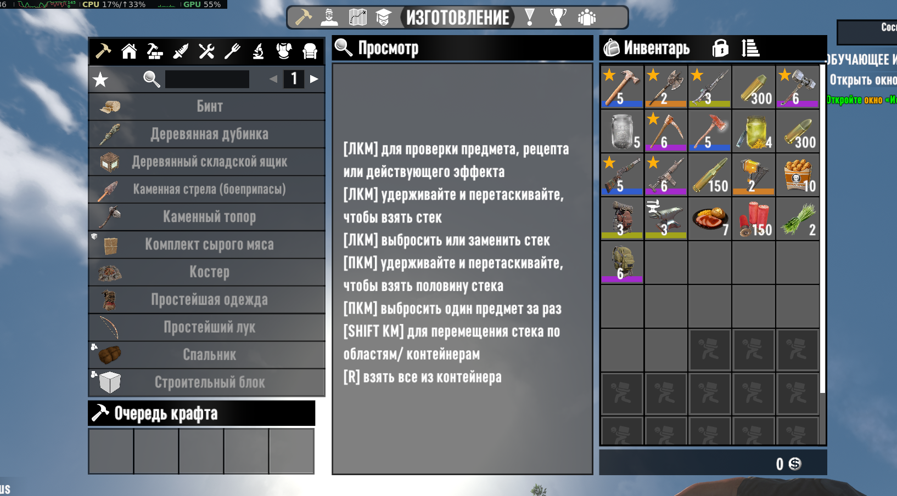
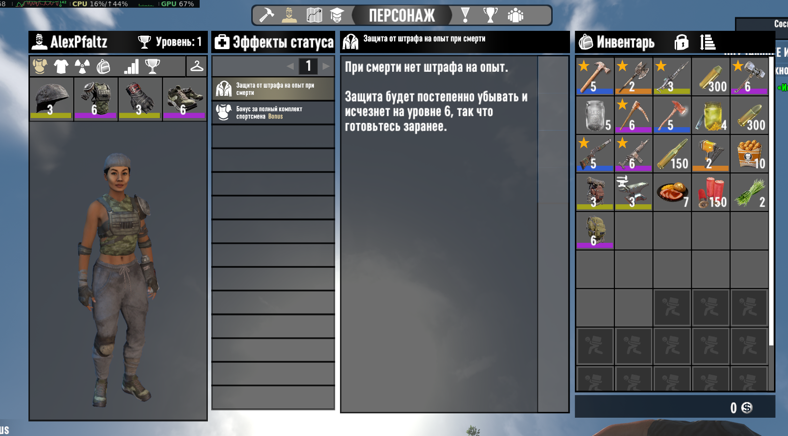
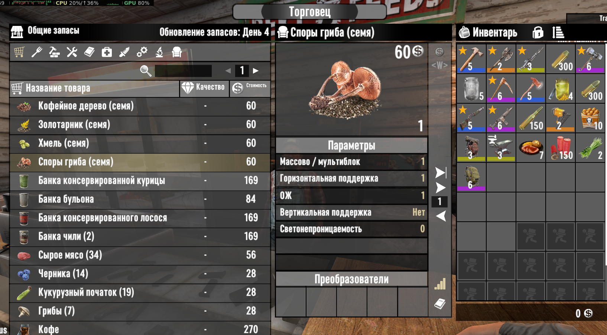

# VerticalUI (VUI)
Server-side Vertical UI for "7 Days to Die"

Adapted to game version 3.3.0 .

## Features
- Vertical item info panel
- Vertical craft info panel
- Vertical active buff panel
- Vertical backpack
- Server-side only — no client install required

## Installation
1. Place `VerticalUI` folder into `Mods/` on the server.
2. Restart the server.
3. Clients connect — UI is applied automatically.

## Compatibility
- Game version: 3.3.0
- Uses `templates.xml` and `windows.xml` and `xui.xml` patches
- Tested with vanilla; other UI mods may conflict

## Screenshots

  
  
  
  
  
  

